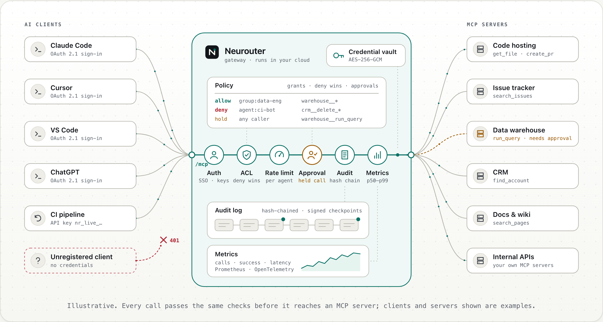

# Neurouter

[](https://github.com/neurouter/neurouter/releases) [](LICENSE) [](https://registry.modelcontextprotocol.io/?q=com.neurouter) [](https://glama.ai/mcp/servers/neurouter/neurouter) [](https://deepwiki.com/neurouter/neurouter) [](https://www.bestpractices.dev/projects/17086)

Self-hosted **enterprise MCP gateway**. Agents connect to one `/mcp` endpoint and reach only the
upstream MCP servers and tools they've been granted; every call is authenticated, authorized,
rate-limited, audited and measured. The same server hosts the admin console and user portal.

<picture>
  <source media="(prefers-color-scheme: dark)" srcset="docs/images/gateway-dark.png">
  
</picture>

Website: [neurouter.com](https://neurouter.com) · Live demo (read-only, simulated data): [neurouter-demo.web.app](https://neurouter-demo.web.app) · Docs: [neurouter.com/docs](https://neurouter.com/docs)

<a href="https://neurouter-demo.web.app"></a>

<sub>38 s walkthrough of the <a href="https://neurouter-demo.web.app">live demo</a> (simulated data): approvals, the live audit log, a blocked tool definition change, grants and metrics.</sub>

> Phase 1 is in progress.

## Requirements

- Node.js **>= 24** (runtime target is Node 26 LTS; CI runs 24 and 26)
- npm 11 (npm workspaces)
- No Docker for local development: the default database is SQLite (with sqlite-vec) in a local file.

## Quick start (local dev, SQLite)

```bash
npm install
cp .env.example .env            # then edit; see "Environment" below
npm run keys -- gen             # prints NEUROUTER_MASTER_KEYS / NEUROUTER_ACTIVE_KEY_ID / HASH_PEPPER for .env
npm run dev                     # API server (tsx watch) + Vite dev server with the API proxy
```

`npm run dev` starts the server, waits for `GET /healthz`, then starts Vite. Open the URL Vite
prints. The server applies migrations on start (`MIGRATE_ON_START=true`) and creates
`apps/server/data/neurouter.db`.

Run them separately if you prefer:

```bash
npm run dev:server              # API on $PORT (default 3000)
npm run dev:web                 # Vite; proxies /api, /mcp, /oauth, /.well-known, /metrics to $NEUROUTER_DEV_API_URL
```

Health checks: `GET /healthz` (liveness, alias `/health`) and `GET /readyz` (DB + audit store).

UI without a backend: set `VITE_ENABLE_MSW=true` and run `npm run dev:web`; the app runs against
MSW handlers generated from the shared API contract.

## Run with Docker Compose (Postgres)

A prod-like stack on one machine: the Neurouter image plus Postgres 18 with pgvector.

```bash
cp .env.example .env
npm run keys -- gen             # paste the three values into .env (never commit them)
docker compose up --build       # http://localhost:3000, MCP endpoint http://localhost:3000/mcp
```

Compose runs the production image in "local production" mode (`NODE_ENV=development` semantics
for login and URLs, because production mode requires an https `PUBLIC_URL` and OIDC). Sign in with
`AUTH_DEV_LOGIN=true` and `BOOTSTRAP_ADMIN_EMAIL=<you>` in `.env`, or use a real IdP:

- `docker compose --profile oidc up` starts a local Dex (`deploy/compose/dex.yaml`, user
  `admin@example.com` / `password`). Set `OIDC_ISSUER=http://<host-ip>:5556/dex`,
  `OIDC_CLIENT_ID=neurouter`, `OIDC_CLIENT_SECRET=neurouter-dev-secret`. The issuer URL must be
  reachable from both your browser and the container.
- `docker compose --profile otel up` adds an OpenTelemetry collector that logs traces and logs;
  set `OTEL_SDK_DISABLED=false`.

The image (see `Dockerfile`) is multi-stage on `node:26-bookworm-slim` (glibc, because the
onnxruntime and sqlite-vec prebuilds target glibc), runs as the non-root `node` user and bakes the
embedding model in, so it needs no network egress for models (`EMBEDDINGS_ALLOW_REMOTE=false`).
Multi-arch build: `docker buildx build --platform linux/amd64,linux/arm64 -t neurouter:<tag> .`

Released images (linux/amd64 and linux/arm64) are published to GHCR, signed with cosign (keyless)
and shipped with an SBOM and build provenance:

```bash
docker pull ghcr.io/neurouter/neurouter:0.1.1
cosign verify ghcr.io/neurouter/neurouter:0.1.1 \
  --certificate-identity-regexp '^https://github.com/neurouter/neurouter/\.github/workflows/release\.yml@' \
  --certificate-oidc-issuer https://token.actions.githubusercontent.com
```

## Kubernetes (Helm)

```bash
kubectl create secret generic neurouter-crypto \
  --from-literal=NEUROUTER_MASTER_KEYS='k1:…' --from-literal=NEUROUTER_ACTIVE_KEY_ID=k1 --from-literal=HASH_PEPPER='…'
kubectl create secret generic neurouter-db --from-literal=DATABASE_URL='postgres://…'
helm install neurouter oci://ghcr.io/neurouter/charts/neurouter --version 0.1.2 \
  --set publicUrl=https://mcp.example.com \
  --set crypto.existingSecret=neurouter-crypto --set database.existingSecret=neurouter-db \
  --set oidc.issuer=https://idp.example.com --set oidc.clientId=neurouter --set oidc.existingSecret=neurouter-oidc \
  --set ingress.enabled=true --set ingress.host=mcp.example.com
```

The chart is also in this repo at `deploy/helm/neurouter`; it defaults to the
`ghcr.io/neurouter/neurouter` image at the chart's `appVersion`.

- Postgres 16+ with the `vector` extension is required for more than one replica (SQLite is
  single-process). Replicas coordinate through Postgres (LISTEN/NOTIFY, advisory locks, leases), so
  rate limits, approvals and caches are shared; no Redis is needed.
- Defaults: 2 replicas, `RollingUpdate` with `maxUnavailable: 0`, a PodDisruptionBudget, a
  read-only root filesystem with an `emptyDir` on `/tmp`, and `migrations.mode=job` (a
  pre-install/pre-upgrade Job migrates; pods skip it). Migrations are forward-only and additive, so
  old and new pods run side by side during a rollout.
- `terminationGracePeriodSeconds` is `approvals.maxTimeoutSec + 30`, so calls held for human
  approval can finish during a rollout. Keep it at least the `approvalMaxTimeoutSec` setting.
- Ingress: SSE (`/mcp` held calls, `/api/approvals/stream`) needs proxy buffering off and long
  read timeouts; the chart's nginx annotations set both.
- Optional: `metrics.serviceMonitor.enabled`, `autoscaling.enabled`, `networkPolicy.enabled`
  (cloud metadata endpoints are always denied), `archive.url` for audit retention archives.

## Keys: generation and rotation

| Variable | What it protects | Rotation |
|---|---|---|
| `NEUROUTER_MASTER_KEYS` | KEKs (`id:base64-32-bytes`, comma-separated) that wrap the data keys (DEKs) encrypting upstream credentials, upstream OAuth tokens and the audit checkpoint MAC key | supported, see below |
| `NEUROUTER_ACTIVE_KEY_ID` | which KEK wraps new DEKs | |
| `HASH_PEPPER` | HMAC pepper for API keys and OAuth tokens | changing it invalidates every API key and OAuth token |

`npm run keys -- gen [keyId]` prints fresh values. Store them in a secret manager and **back them
up**: without the KEKs, stored credentials can't be decrypted, and without the pepper no API key
works.

KEK rotation (no downtime):

1. Generate a new key (`npm run keys -- gen k2`) and append it: `NEUROUTER_MASTER_KEYS=k1:…,k2:…`.
   Set `NEUROUTER_ACTIVE_KEY_ID=k2` and roll the deployment.
2. As an admin, `POST /api/system/keys/rotate {"type":"rewrap"}` rewraps every DEK under `k2`.
   Poll `GET /api/jobs/:id`. The result's `kekIdsInUse` lists the KEKs still referenced.
3. When `k1` is no longer in `kekIdsInUse`, remove it from `NEUROUTER_MASTER_KEYS` and roll again.

DEK rotation: `POST /api/system/keys/rotate {"type":"dek"}` creates a new data key, re-encrypts
every secret under it and deletes retired DEKs that nothing references.

API keys look like `nr_live_<10-char id>_<43-char secret>`. The fixed prefix lets secret scanners
match them (e.g. a GitHub custom pattern `nr_live_[0-9A-Z]{10}_[0-9A-Za-z]{43}`). Only an HMAC of
the secret is stored; a leaked key is revoked from the agent's page and stops working at once on
every replica.

## Backup and restore

- **What to back up:** the main database, the audit database if `AUDIT_DATABASE_URL` is separate,
  and the crypto secret (KEKs + pepper). A database backup without the keys can't decrypt upstream
  credentials; the keys without the database are useless.
- **Postgres:** `pg_dump -Fc "$DATABASE_URL" > neurouter.dump` (and the same for the audit DB).
  Restore into an empty database with `pg_restore -d "$DATABASE_URL" neurouter.dump`, start
  Neurouter with the **same** crypto values, then run an audit verification (below).
- **SQLite:** stop the server (or use `sqlite3 neurouter.db ".backup backup.db"` while it runs),
  then copy the file. Restore by putting the file back at `DATABASE_URL`.
- Audit retention archives (`AUDIT_ARCHIVE_URL`: `file:`, `s3://`, `gs://`, `azblob://`) are
  written before rows are deleted; keep them under the same retention policy as your backups.
- Migrations are forward-only in production: restore a backup taken by the same or an older
  version, then let the newer version migrate it.

## Audit log verification

Every audit row is hash-chained (`sha256(prev_hash ‖ JCS(row))`), and a checkpoint signed with an
HMAC key derived from the KEKs is written every 10,000 rows or 5 minutes, on key rotation and before
every retention cut.

- UI: Audit log → **Verify**. API: `POST /api/audit/verify {"from"?, "to"?}` (ISO timestamps; omit both to verify the whole retained log) (auditor or
  admin) returns `202 {jobId}`; poll `GET /api/jobs/:id`. The result is
  `{ ok, checked, firstSeq, lastSeq, checkpointsVerified, brokenAt }`; `brokenAt` names the first
  row whose hash, link or checkpoint doesn't match. The run itself is audited.
- **Threat model, honestly:** someone with database write access can rewrite rows and recompute
  the chain, but can't forge checkpoint MACs without the KEKs. Deleting the newest rows is only
  detectable up to the last checkpoint that left the database, so export audit events (webhook or
  OTLP logs sink, Settings → Export) to a system the database admins don't control.

## Security model

- **Identity:** people sign in with OIDC (authorization code + PKCE); sessions are server-side,
  HttpOnly cookies with CSRF tokens. Roles come from IdP groups (`OIDC_ADMIN_GROUPS`,
  `OIDC_AUDITOR_GROUPS`). `AUTH_DEV_LOGIN` is refused outside development.
- **Agents** authenticate to `/mcp` with an API key or an OAuth access token issued by Neurouter's
  own authorization server (RFC 8414 metadata, client ID metadata documents, dynamic registration,
  PKCE S256, audience-bound tokens, rotating refresh tokens). Client tokens are never forwarded
  upstream.
- **Authorization:** grants on servers or tools to users, groups or agents; deny wins; an agent
  can be narrowed below its user. Tools the caller may not use are indistinguishable from unknown
  tools, in search results and in errors.
- **Tool pinning:** each tool definition is hashed and must be approved; a changed upstream
  definition ("rug pull") is blocked until an owner re-approves it. Arguments are validated against
  the pinned schema.
- **Human approval:** `requires_approval` tools are held until an owner or admin approves (never the
  requester), the approval expires, or the client cancels. Clients that time out sooner should send
  a `progressToken`; Neurouter sends progress every 10 s while a call is held.
- **Upstream credentials** (shared bearer, headers, per-user OAuth) are envelope-encrypted
  (AES-256-GCM DEKs wrapped by the KEKs). Outbound requests are SSRF-guarded: cloud metadata
  ranges are always denied, private networks are configurable (`UPSTREAM_ALLOW_PRIVATE_NETWORKS`,
  `OUTBOUND_ALLOW_PRIVATE_NETWORKS`).
- **Audit:** every MCP call, search, admin change and sign-in is audited with redaction rules
  applied before storage (secrets in arguments are never written).
- **Web:** strict CSP (`default-src 'self'`, no inline script), `frame-ancestors 'none'`, and the
  `/mcp` endpoint checks `Origin` against `PUBLIC_URL` and `MCP_ALLOWED_ORIGINS`.

## Scripts (repo root)

| Command | What it does |
|---|---|
| `npm run dev` | server + web in watch mode |
| `npm run build` | `packages/shared` → `apps/web/dist` → `apps/server/dist` |
| `npm start` | runs the built server (`node apps/server/dist/main.js`) |
| `npm test` | all Vitest unit tests (projects: shared, server, web) |
| `npm run test:e2e` | build, then the Playwright browser suite (`apps/web/e2e`) |
| `npm run coverage` | tests with v8 coverage |
| `npm run typecheck` | `tsc -b` for every workspace (TypeScript 6.0.3) |
| `npm run lint` | ESLint (flat config) |
| `npm run db:migrate -- up\|down\|status [--set main\|audit]` | migration CLI (`down` is dev-only) |
| `npm run keys -- gen` | generate crypto env values |

## Repository layout

```
package.json · tsconfig.base.json · tsconfig.json · vitest.config.ts · eslint.config.js · .env.example
scripts/dev.mjs                  # starts server, waits for /healthz, starts web
packages/shared/                 # @neurouter/shared — isomorphic, zod only (no Node imports)
  src/domain/                    # enums, roles, capabilities + can() (shared by server guards and the UI)
  src/mcp/                       # tool naming (<slug>__<tool>), _meta keys, meta-tool JSON Schemas
  src/api/                       # the Phase 1 REST contract: one file per area (zod request/response
                                 #   schemas + types), common.ts (Problem, Page<T>, cursor query),
                                 #   endpoint.ts (endpoint()/buildPath/serializeQuery), routes.ts (registry)
apps/server/                     # @neurouter/server — Fastify 5 API + (later) MCP gateway
  src/main.ts · app.ts           # bootstrap / pure wiring (buildApp is fastify.inject-testable)
  src/config/                    # zod env schema (env.ts) + loader (load.ts)
  src/lib/                       # clock, ids (UUIDv7), crypto, JCS, errors, pagination, json, logger
  src/api/                       # problem+json error handler, registerEndpoint() from the shared contract
  src/db/                        # Kysely: sqlite.ts (better-sqlite3 + sqlite-vec), postgres.ts (pg + pgvector),
                                 #   index.ts (main + audit DBs), migrator.ts, schema.ts, migrations/{main,audit}
  src/audit/store.ts             # AuditStore interface (+ SQL scaffold stub)
  src/coordination/              # CoordinationStore interface + in-memory implementation
  src/jobs/scheduler.ts          # croner + lease-based leadership
  src/health/ · src/web/         # /healthz /readyz /health · production static serving + SPA fallback
  src/scripts/                   # migrate.ts, keys.ts CLIs
  src/test/fakes/                # test DB, recording Kysely driver (compiles Postgres SQL without a DB), app builder
apps/web/                        # @neurouter/web — Vite 8 + React 19 + Tailwind 4 + shadcn (Base UI)
  index.html · public/theme-init.js   # pre-paint theme script (light/dark/system, CSP-safe)
  vite.config.ts · dev-proxy.ts  # TanStack Router plugin, dev proxy from NEUROUTER_DEV_API_URL
  src/app/                       # router, query client (401/403 policy), providers, nav IA, route guards
  src/routes/                    # file routes (TanStack Router); routeTree.gen.ts is generated
  src/components/ui/             # shadcn-generated (CLI-owned)
  src/components/layout/         # app shell: sidebar (per role), top bar (breadcrumbs, theme, user menu)
  src/features/auth/             # me/badges queries, guards (requireAuth, requireAnyCapability, landingPath)
  src/lib/                       # api-client (problem+json → ApiError, CSRF, contract parsing)
  src/mocks/                     # MSW handlers generated from the shared contract + fixtures
```

## Database

- **Local**: `DATABASE_URL=sqlite:./data/neurouter.db` (relative to `apps/server`). sqlite-vec is
  loaded on every connection; FTS5 is compiled into better-sqlite3.
- **Production**: `DATABASE_URL=postgres://…` (PG 16+, target 18) with the `vector` extension
  (the migration runs `CREATE EXTENSION IF NOT EXISTS vector`; it fails with a clear message if the
  role lacks the privilege).
- **Audit DB**: `AUDIT_DATABASE_URL` (optional, defaults to `DATABASE_URL`). Audit log, sessions and
  metric rollups live there, with their own pool and migration table (`kysely_audit_migration`).
- Migrations are TypeScript, one set per database, applied under Kysely's DB lock (safe with
  replicas). Production is forward-only.

## Environment

All variables are documented in [`.env.example`](.env.example). Production requires `PUBLIC_URL`
(https), `NEUROUTER_MASTER_KEYS`, `NEUROUTER_ACTIVE_KEY_ID`, `HASH_PEPPER` and the OIDC trio. In
development the server falls back to ephemeral keys (with a warning) so it boots with no `.env`.

Web dev variables (read by `apps/web/vite.config.ts` from the repo-root `.env`):
`NEUROUTER_DEV_API_URL` (required for `dev:web`), `NEUROUTER_WEB_DEV_PORT` (optional),
`VITE_ENABLE_MSW`. When you use the UI through Vite, set `PUBLIC_URL` to the Vite origin.

## Tests

Unit tests (Vitest 5): `npm test`. Server tests run against in-memory SQLite with all
migrations; Postgres SQL paths are compiled through a recording Kysely driver and asserted without
a database. Web tests use jsdom, Testing Library and MSW handlers generated from the contract.

End-to-end (Playwright, Chromium): `npm run test:e2e` builds everything, then
`apps/web/playwright.config.ts` boots the built server (SQLite in a temp dir, dev login,
generated keys) and fake upstream MCP servers (`apps/web/e2e/support/upstream-server.ts`) on free
ports. Specs seed data through the API with unique names, so they are independent and run in
parallel. First time: `npx playwright install chromium`. After a build you can run
`npm run test:e2e -w @neurouter/web -- e2e/catalog.spec.ts` for one spec. Vitest never picks up
`apps/web/e2e`.

## License

Apache-2.0. See [LICENSE](LICENSE) and [NOTICE](NOTICE).
